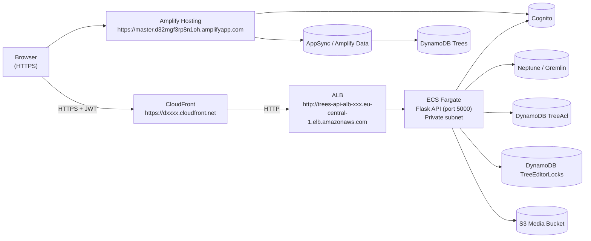
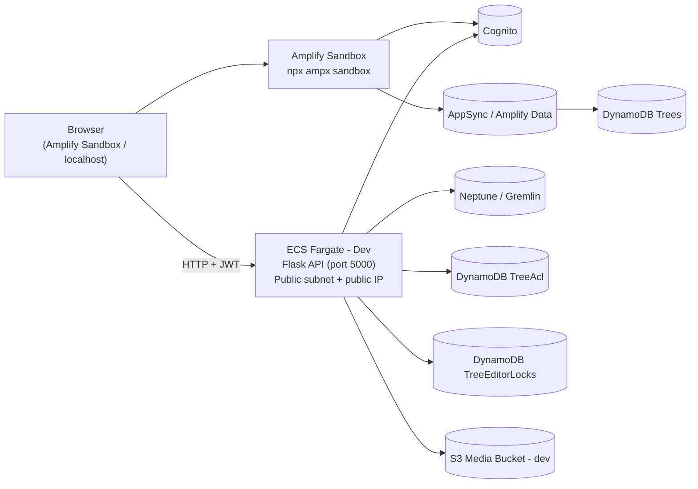
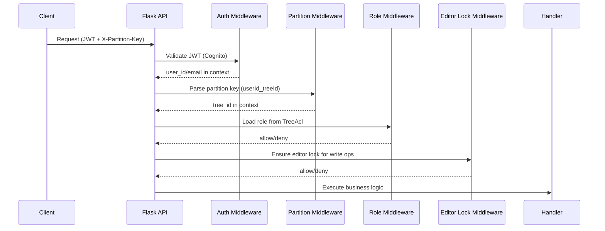
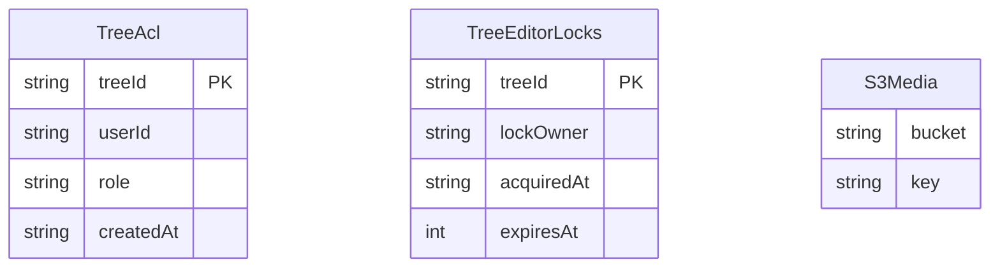
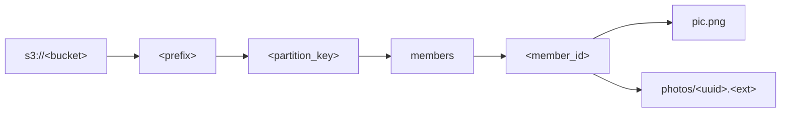

## Architecture Overview

---

### Production Architecture

The production frontend is served over **HTTPS** from Amplify Hosting. Browsers
enforce mixed-content policy and will block requests from an HTTPS page to a
plain HTTP endpoint. To avoid this without requiring a custom domain or an ACM
certificate on the ALB, a **CloudFront distribution** is placed in front of the
ALB. CloudFront terminates HTTPS and forwards traffic to the ALB over HTTP
inside AWS.

**Key points:**
- ECS tasks run in **private subnets**; only the ALB can reach them (security group allows port 5000 from the ALB's security group only).
- CloudFront provides the HTTPS endpoint; CORS_ORIGINS on the ECS task must include the Amplify frontend origin (e.g. `https://master.d32mgf3rp8n1oh.amplifyapp.com`).

---

### Development Architecture

There is no ALB in front of the dev ECS service. The dev ECS task runs in a
**public subnet** with a public IP assigned and port 5000 open to the internet,
allowing the sandbox frontend to reach it directly.

**Key points:**
- The dev ECS task runs in a **public subnet** with **Assign public IP = ON** and no ALB.
- The task's security group allows inbound TCP 5000 from `0.0.0.0/0` (no ALB SG rule needed).
- The task's public IP is **ephemeral** — it changes when the task is replaced. Update `VITE_FLASK_API_URL` in `.env.local` after each task replacement.
- `VITE_FLASK_API_URL=http://<task-public-ip>:5000` in `.env.local` (not committed).
- CORS_ORIGINS on the dev ECS task must include the sandbox origin (e.g. `http://localhost:5173`).

---

### Request Flow (Protected Endpoints)

Applies to both prod and dev.

---

### Data Stores

---

### S3 Media Key Layout

